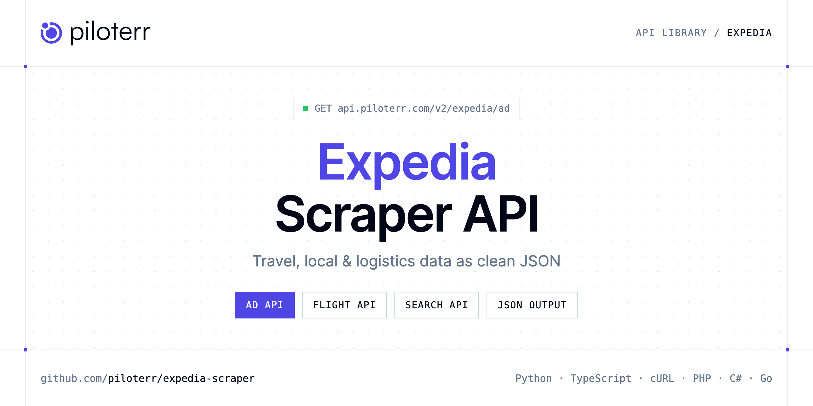

<p align="center">
  <a href="https://www.piloterr.com"></a>
</p>

# Expedia Scraper API

[](https://discord.gg/CFj3ph8aHU) [](https://app.piloterr.com) [](https://app.piloterr.com/openapi) [](LICENSE)

The **Piloterr Expedia Scraper API** lets you extract public data from Expedia as **clean, structured JSON** — no proxies, headless browsers or HTML parsing to maintain. Endpoints available in production:

- **Expedia Ad API** — Fetch one Expedia hotel from its information URL: name, postal address, and amenity groups.
- **Expedia Flight API** — Search Expedia flights by airport route and dates, or by a flight search URL.
- **Expedia Search API** — Execute a hotel search on Expedia using a direct search URL and receive structured hotel listings with prices, ratings, and availability.

Use it for price tracking, review and reputation monitoring, local market research or logistics tracking.

| Endpoint | Path | Credits | What you get |
|---|---|---|---|
| [Expedia Ad API](#expedia-ad-api) | `/v2/expedia/ad` | 2 | Fetch one Expedia hotel from its information URL |
| [Expedia Flight API](#expedia-flight-api) | `/v2/expedia/flight` | 2 | Search Expedia flights by airport route and dates, or by a flight search URL. Each offer includes the airline, times, stops, and displayed price. |
| [Expedia Search API](#expedia-search-api) | `/v2/expedia/search` | 2 | Execute a hotel search on Expedia using a direct search URL and receive structured hotel listings with prices, ratings, and availability. |

## Table of contents

- [How it works](#how-it-works)
- [Expedia Ad API](#expedia-ad-api)
- [Expedia Flight API](#expedia-flight-api)
- [Expedia Search API](#expedia-search-api)
- [Code examples in other languages](#code-examples-in-other-languages)
- [Practical use cases](#practical-use-cases)
- [Why Piloterr?](#why-piloterr)
- [FAQ](#faq)
- [Related scrapers](#related-scrapers)
- [Support](#support)

## How it works

1. **Create a free Piloterr account** and copy your API key from the [dashboard](https://app.piloterr.com).
2. **Send a `GET` (or `POST`) request** to `https://api.piloterr.com/v2/...` with the header `x-api-key: YOUR_API_KEY`.
3. **Receive structured JSON** — Piloterr handles rendering, proxies, retries and parsing.

```bash
export PILOTERR_API_KEY="your-api-key"
pip install requests        # Python
# TypeScript: Node.js 18+ (native fetch), run with `npx tsx file.ts`
```

> Every endpoint accepts both `GET` (query string) and `POST` (JSON body with the same fields).

## Expedia Ad API

Fetch one Expedia hotel from its information URL: name, postal address, and amenity groups.

`GET | POST https://api.piloterr.com/v2/expedia/ad` · **2 credits per request** · [Full reference](https://app.piloterr.com/openapi)

### Request parameters

| Parameter | Type | Required | Description |
|---|---|---|---|
| `query` | string | ✅ | An Expedia hotel information URL. The response is one flat hotel. hotel_id comes from .h{id}.Hotel-Information when that pattern is in the URL, and is null otherwise. A destination, a non-Expedia URL, or an empty value r… |

### Python example

```python
import json
import os
import requests

response = requests.get(
    "https://api.piloterr.com/v2/expedia/ad",
    headers={"x-api-key": os.environ["PILOTERR_API_KEY"]},
    params={
        "query": "https://www.expedia.com/New-York-Hotels-Hilton-New-York-Fashion-District.h3117215.Hotel-Information",
    },
    timeout=120,
)
response.raise_for_status()
data = response.json()

print(json.dumps(data, indent=2, ensure_ascii=False)[:2000])
```

### TypeScript example

```typescript
type ExpediaAd = {
  url?: string;
  name?: string;
  address?: {
    city?: string;
    region?: string;
    street?: string;
    country?: string;
    postal_code?: string;
  };
  hotel_id?: string;
  amenities?: {
    name?: string;
    items?: string[];
  }[];
};

const params = new URLSearchParams({
  "query": "https://www.expedia.com/New-York-Hotels-Hilton-New-York-Fashion-District.h3117215.Hotel-Information",
});

const response = await fetch(`https://api.piloterr.com/v2/expedia/ad?${params}`, {
  headers: { "x-api-key": process.env.PILOTERR_API_KEY! },
});
if (!response.ok) throw new Error(`Piloterr error ${response.status}: ${await response.text()}`);

const data = (await response.json()) as ExpediaAd;

console.log(JSON.stringify(data, null, 2).slice(0, 2000));
```

<details>
<summary><b>POST variant</b></summary>

```http
POST https://api.piloterr.com/v2/expedia/ad
x-api-key: YOUR_API_KEY
Content-Type: application/json

{"query": "https://www.expedia.com/New-York-Hotels-Hilton-New-York-Fashion-District.h3117215.Hotel-Information"}
```
</details>

### Output example

Example response from the API reference, abridged — real values depend on the page you scrape.

```json
{
  "url": "https://www.expedia.com/New-York-Hotels-Hilton-New-York-Fashion-District.h3117215.Hotel-Information",
  "name": "Hilton New York Fashion District",
  "address": {
    "city": "New York",
    "region": "NY",
    "street": "152 W 26th Street",
    "country": "USA",
    "postal_code": "10001"
  },
  "hotel_id": "3117215",
  "amenities": [
    {
      "name": "Internet",
      "items": [
        "Available in all rooms: Free WiFi"
      ]
    }
  ]
}
```

### Response fields

| Field | Type | Description |
|---|---|---|
| `url` | string |  |
| `name` | string |  |
| `address` | object |  |
| `address.city` | string |  |
| `address.region` | string |  |
| `address.street` | string |  |
| `address.country` | string |  |
| `address.postal_code` | string |  |
| `hotel_id` | string |  |
| `amenities[]` | object[] |  |
| `amenities[].name` | string |  |
| `amenities[].items` | string[] |  |

## Expedia Flight API

Search Expedia flights by airport route and dates, or by a flight search URL. Each offer includes the airline, times, stops, and displayed price.

`GET | POST https://api.piloterr.com/v2/expedia/flight` · **2 credits per request** · [Full reference](https://app.piloterr.com/openapi)

### Request parameters

| Parameter | Type | Required | Description |
|---|---|---|---|
| `query` | string | ✅ | A route or a full Expedia Flights-Search URL. Empty, a route without two airport codes, or a non-Expedia URL returns 400. A full URL is opened as given. price stays the label on the offer. pagination.next is null. |
| `departure_date` | string | — | Departure as YYYY-MM-DD for a route. Omit it and the route uses 2026-11-15. A value that is not YYYY-MM-DD returns 400. Ignored when query is a full URL. |
| `return_date` | string | — | Return date as YYYY-MM-DD. Omit it for a one-way trip. A value that is not YYYY-MM-DD returns 400. Ignored when query is a full URL. |
| `adults` | number | — | Adult passengers for a route. Omit it and the request uses 1. Ignored when query is a full URL. |
| `cabin_class` | string | — | Label copied onto every result as cabin_class. Omit it and each result uses economy. It does not add a cabin filter to the Expedia URL. |
| `region` | string | — | Host for a route. Omit it for www.expedia.com. Allowed: us, ca, uk, au, fr, de, es, it, nl, mx. Any other value returns 400. Ignored when query is a full URL. |

### Python example

```python
import json
import os
import requests

response = requests.get(
    "https://api.piloterr.com/v2/expedia/flight",
    headers={"x-api-key": os.environ["PILOTERR_API_KEY"]},
    params={
        "query": "JFK-LAX",
    },
    timeout=120,
)
response.raise_for_status()
data = response.json()

print(json.dumps(data, indent=2, ensure_ascii=False)[:2000])
```

### TypeScript example

```typescript
type ExpediaFlight = {
  results?: {
    price?: string;
    stops?: string;
    origin?: string;
    airline?: string;
    duration?: string;
    cabin_class?: string;
    destination?: string;
    arrival_time?: string;
    departure_time?: string;
  }[];
  pagination?: {
    next?: unknown;
    page?: number;
    per_page?: number;
    total_pages?: unknown;
    total_results?: unknown;
  };
};

const params = new URLSearchParams({
  "query": "JFK-LAX",
});

const response = await fetch(`https://api.piloterr.com/v2/expedia/flight?${params}`, {
  headers: { "x-api-key": process.env.PILOTERR_API_KEY! },
});
if (!response.ok) throw new Error(`Piloterr error ${response.status}: ${await response.text()}`);

const data = (await response.json()) as ExpediaFlight;

console.log(JSON.stringify(data, null, 2).slice(0, 2000));
```

<details>
<summary><b>POST variant</b></summary>

```http
POST https://api.piloterr.com/v2/expedia/flight
x-api-key: YOUR_API_KEY
Content-Type: application/json

{"query": "JFK-LAX"}
```
</details>

### Output example

Example response from the API reference, abridged — real values depend on the page you scrape.

```json
{
  "results": [
    {
      "price": "$269",
      "stops": "Nonstop",
      "origin": "JFK",
      "airline": "Delta",
      "duration": "6h 13m",
      "cabin_class": "economy",
      "destination": "LAX",
      "arrival_time": "6:33pm",
      "departure_time": "3:20pm"
    }
  ],
  "pagination": {
    "next": null,
    "page": 1,
    "per_page": 1,
    "total_pages": null,
    "total_results": null
  }
}
```

### Response fields

| Field | Type | Description |
|---|---|---|
| `results[]` | object[] |  |
| `results[].price` | string |  |
| `results[].stops` | string |  |
| `results[].origin` | string |  |
| `results[].airline` | string |  |
| `results[].duration` | string |  |
| `results[].cabin_class` | string |  |
| `results[].destination` | string |  |
| `results[].arrival_time` | string |  |
| `results[].departure_time` | string |  |
| `pagination` | object |  |
| `pagination.next` | object |  |
| `pagination.page` | integer |  |
| `pagination.per_page` | integer |  |
| `pagination.total_pages` | object |  |
| `pagination.total_results` | object |  |

## Expedia Search API

Execute a hotel search on Expedia using a direct search URL and receive structured hotel listings with prices, ratings, and availability.

`GET | POST https://api.piloterr.com/v2/expedia/search` · **2 credits per request** · [Full reference](https://app.piloterr.com/openapi)

### Request parameters

| Parameter | Type | Required | Description |
|---|---|---|---|
| `query` | string | ✅ | A valid Expedia hotel search URL. Copy the URL directly from your Expedia search results page. |

### Python example

```python
import json
import os
import requests

response = requests.get(
    "https://api.piloterr.com/v2/expedia/search",
    headers={"x-api-key": os.environ["PILOTERR_API_KEY"]},
    params={
        "query": "https://euro.expedia.net/Hotel-Search?currency=EUR&siteid=4400&destination=Toulouse",
    },
    timeout=120,
)
response.raise_for_status()
data = response.json()

print(json.dumps(data, indent=2, ensure_ascii=False)[:2000])
```

### TypeScript example

```typescript
type ExpediaSearch = {
  results?: {
    name?: string;
    location?: string;
    room_info?: string;
    taxes_info?: string;
    description?: string;
    rating_text?: string;
    star_rating?: number;
    is_sponsored?: boolean;
    rating_score?: number;
    current_price?: number;
    reviews_count?: number;
    discount_badge?: unknown;
    special_offers?: string[];
    taxes_included?: boolean;
    rating_category?: string;
    current_price_text?: string;
  }[];
};

const params = new URLSearchParams({
  "query": "https://euro.expedia.net/Hotel-Search?currency=EUR&siteid=4400&destination=Toulouse",
});

const response = await fetch(`https://api.piloterr.com/v2/expedia/search?${params}`, {
  headers: { "x-api-key": process.env.PILOTERR_API_KEY! },
});
if (!response.ok) throw new Error(`Piloterr error ${response.status}: ${await response.text()}`);

const data = (await response.json()) as ExpediaSearch;

console.log(JSON.stringify(data, null, 2).slice(0, 2000));
```

<details>
<summary><b>POST variant</b></summary>

```http
POST https://api.piloterr.com/v2/expedia/search
x-api-key: YOUR_API_KEY
Content-Type: application/json

{"query": "https://euro.expedia.net/Hotel-Search?currency=EUR&siteid=4400&destination=Toulouse"}
```
</details>

### Output example

Example response from the API reference, abridged — real values depend on the page you scrape.

```json
{
  "results": [
    {
      "name": "Campanile Toulouse Sud - Labege Innopole",
      "location": "Labege",
      "room_info": "for 1 room",
      "taxes_info": "includes taxes & fees",
      "description": "Tranquil stay near Citè de l'Espace - Embrace serenity with a garden terrace, French cuisine, and eco-friendly comforts. Enjoy premium be…",
      "rating_text": "Very good",
      "star_rating": 3,
      "is_sponsored": false,
      "rating_score": 8.4,
      "current_price": 63,
      "reviews_count": 497,
      "discount_badge": null,
      "special_offers": [
        "Fully refundable",
        "Reserve now, pay later"
      ],
      "taxes_included": true,
      "rating_category": "excellent",
      "current_price_text": "€63"
    },
    {
      "name": "Appart Hotel Odalys City Centre Compans Caffarelli",
      "location": "Toulouse City-Centre",
      "room_info": "for 1 room",
      "taxes_info": "includes taxes & fees",
      "rating_text": "Wonderful",
      "star_rating": 3,
      "is_sponsored": false,
      "rating_score": 9.2,
      "current_price": 71,
      "reviews_count": 355,
      "discount_badge": "26% off",
      "original_price": 96,
      "special_offers": null,
      "taxes_included": true,
      "rating_category": "excellent",
      "current_price_text": "€71",
      "original_price_text": "€96"
    }
  ]
}
```

### Response fields

| Field | Type | Description |
|---|---|---|
| `results[]` | object[] |  |
| `results[].name` | string |  |
| `results[].location` | string |  |
| `results[].room_info` | string |  |
| `results[].taxes_info` | string |  |
| `results[].description` | string |  |
| `results[].rating_text` | string |  |
| `results[].star_rating` | integer |  |
| `results[].is_sponsored` | boolean |  |
| `results[].rating_score` | number |  |
| `results[].current_price` | integer |  |
| `results[].reviews_count` | integer |  |
| `results[].discount_badge` | object |  |
| `results[].special_offers` | string[] |  |
| `results[].taxes_included` | boolean |  |
| `results[].rating_category` | string |  |
| `results[].current_price_text` | string |  |

## Code examples in other languages

Ready-to-run examples live in the [`examples/`](examples) folder. Each one reads your key from the `PILOTERR_API_KEY` environment variable.

| Language | Ad | Flight | Search |
|---|---|---|---|
| cURL (Bash) | [`ad`](examples/curl/ad.sh) | [`flight`](examples/curl/flight.sh) | [`search`](examples/curl/search.sh) |
| PHP | [`ad`](examples/php/ad.php) | [`flight`](examples/php/flight.php) | [`search`](examples/php/search.php) |
| C# | [`ad`](examples/csharp/Ad.cs) | [`flight`](examples/csharp/Flight.cs) | [`search`](examples/csharp/Search.cs) |
| Go | [`ad`](examples/go/ad.go) | [`flight`](examples/go/flight.go) | [`search`](examples/go/search.go) |
| Java | [`ad`](examples/java/AdExample.java) | [`flight`](examples/java/FlightExample.java) | [`search`](examples/java/SearchExample.java) |
| Ruby | [`ad`](examples/ruby/ad.rb) | [`flight`](examples/ruby/flight.rb) | [`search`](examples/ruby/search.rb) |
| Node.js | [`ad`](examples/nodejs/ad.mjs) | [`flight`](examples/nodejs/flight.mjs) | [`search`](examples/nodejs/search.mjs) |

## Practical use cases

- **Price tracking** — Monitor rates and offers over time.
- **Reputation monitoring** — Track ratings and reviews of venues and competitors.
- **Local market research** — Map businesses, venues and events by area.
- **Logistics visibility** — Follow shipments and statuses where available.
- **Travel products** — Power comparison tools and alerts with structured data.

## Why Piloterr?

- **No infrastructure** — no proxies, headless browsers or CAPTCHA solving to run yourself.
- **Structured JSON** — stable, documented fields instead of brittle HTML selectors.
- **Pay per request** — transparent credit cost per endpoint, failed requests are retried for you.
- **One API key, hundreds of sources** — Expedia plus many other e-commerce, search and company data endpoints in the [Piloterr library](https://www.piloterr.com/library).
- **Any language** — plain HTTPS + JSON, with examples for Python, TypeScript, cURL, PHP, C#, Go, Java, Ruby and Node.js.

## FAQ

### Is it legal to scrape Expedia?

Collecting publicly available data is generally allowed in many jurisdictions, but rules depend on your country, the data you collect and how you use it. Avoid personal data unless you have a lawful basis, respect the website's terms where they apply, and get legal advice for your specific use case. This is not legal advice.

### Do I need proxies or a headless browser?

No. Piloterr handles rendering, proxy rotation and retries on its side. You only send an HTTPS request with your `x-api-key` header and receive JSON.

### How much does a request cost?

Credits per call: `/v2/expedia/ad` **2**, `/v2/expedia/flight` **2**, `/v2/expedia/search` **2**. See the [Piloterr website](https://www.piloterr.com) for plans.

### What data does the Expedia API return?

Each endpoint returns structured JSON: **Expedia Ad** — `url`, `name`, `address`, `address.city`, `address.region`, `address.street`; **Expedia Flight** — `results[]`, `results[].price`, `results[].stops`, `results[].origin`, `results[].airline`, `results[].duration`; **Expedia Search** — `results[]`, `results[].name`, `results[].location`, `results[].room_info`, `results[].taxes_info`, `results[].description`.

### Can I target a specific country or language?

Yes, use `region` — see the parameter tables above for accepted values.

### Which languages are supported?

Any language that can make an HTTP request. This README shows Python and TypeScript; the [`examples/`](examples) folder contains cURL, PHP, C#, Go, Java, Ruby and Node.js.

## Related scrapers

- [Auto Europe Scraper API](https://github.com/piloterr/autoeurope-scraper)
- [Eventbrite Scraper API](https://github.com/piloterr/eventbrite-scraper)
- [Maersk Scraper API](https://github.com/piloterr/maersk-scraper)
- [TheFork Scraper API](https://github.com/piloterr/thefork-scraper)
- [Yelp Scraper API](https://github.com/piloterr/yelp-scraper)
- [All Piloterr scrapers on GitHub](https://github.com/piloterr)

## Support

- 💬 Join the [Piloterr Discord](https://discord.gg/CFj3ph8aHU) to ask questions and share what you build.
- 📚 Browse the [API reference (OpenAPI)](https://app.piloterr.com/openapi) and the [Piloterr library](https://www.piloterr.com/library).
- 🔑 [Get your API key](https://app.piloterr.com).

---

<p align="center">
  <a href="https://www.piloterr.com">
    <picture>
      <source media="(prefers-color-scheme: dark)" srcset="images/logo-dark.svg">
      
    </picture>
  </a>
  <br>
  <sub>Built by <a href="https://www.piloterr.com">Piloterr</a> — web scraping APIs for e-commerce, search, real estate and more, one API key.</sub>
</p>

<sub>Expedia is a trademark of its respective owner. This repository is not affiliated with or endorsed by Expedia. Examples are released under the MIT license.</sub>
